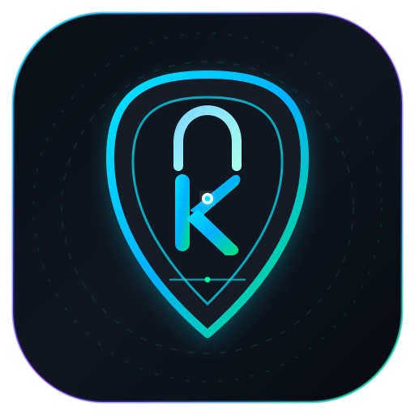

# KripDroid - Suite Kriptografi Material You untuk Android

<p align="center">
  
</p>

<p align="center">
  <b>Aplikasi Enkripsi & Dekripsi Multi-Algoritma Berkinerja Tinggi Berbasis Pure Kotlin & Jetpack Compose (Material Design 3)</b>
</p>

<p align="center">
  <a href="LICENSE"></a>
  <a href="https://github.com/sunandar3221/KripDroid/releases"></a>
  
  
  
</p>

---

## 🌟 Tentang KripDroid

**KripDroid** adalah suite kriptografi modern untuk perangkat Android yang ditulis murni dalam bahasa **Kotlin** menggunakan toolkit antarmuka grafis deklaratif **Google Jetpack Compose (Material You / Material 3)**.

Aplikasi ini dirancang untuk beroperasi secara **100% offline tanpa koneksi internet**, menjamin kerahasiaan (*confidentiality*) dan integritas (*integrity*) data teks serta file biner sensitif Anda. Dilengkapi proteksi hardware **Android KeyStore**, autentikasi **Biometrik Native (Sidik Jari / Wajah)**, dan fitur **Pemulihan Ekstensi Otomatis (*Auto-Extension Recovery*)** saat dekripsi file biner.

---

## 🚀 Fitur Unggulan

- **Pure Kotlin & Jetpack Compose (Material Design 3)**:
  - Antarmuka dinamis modern bertema *Dark Obsidian & Emerald/Teal*.
  - Laci navigasi *Drawer*, *Top App Bar*, dan bilah navigasi bawah (*Bottom Navigation Bar*).
- **Tab Pengaturan Lengkap**:
  - Profil Pengembang: **`sunandar3221`**
  - Repositori: [github.com/sunandar3221/KripDroid](https://github.com/sunandar3221/KripDroid)
  - Lisensi Resmi: **GNU General Public License v3 (GPLv3)**
  - Status Keamanan: Android KeyStore Hardware-backed Key (AES-256) & Status Sensor Biometrik
  - Manajemen Master Password (Buat, Verifikasi, dan Ubah Kata Sandi).
- **Proteksi Hardware Android KeyStore & BiometricPrompt**:
  - Mengamankan kunci enkripsi langsung di modul keamanan perangkat keras (*Hardware-backed Keystore*).
  - Terintegrasi dengan sensor sidik jari, pemindai wajah, dan kredensial perangkat melalui `androidx.biometric`.
- **Pemulihan Ekstensi File Otomatis (*Auto-Extension Recovery*)**:
  - Saat file biner apa pun dienkripsi (`.mp4`, `.pdf`, `.docx`, `.zip`, `.png`, dll.), KripDroid merekam ekstensi format aslinya ke dalam header aman `KRIPDROID\x03`.
  - Saat file didekripsi, KripDroid otomatis mengembalikan ekstensi dan format dokumen tanpa perlu diingat atau diketik manual.
- **Dukungan Native Storage Access Framework (SAF)**:
  - Pemilihan file dan penyimpanan hasil ekspor langsung menggunakan File Picker bawaan Android secara aman (*Scoped Storage compliant*).
- **13 Spektrum Algoritma Kriptografi**:
  - Dari cipher klasik untuk edukasi hingga cipher modern berstandar militer (AES-256-GCM, ChaCha20-Poly1305) dengan derivasi memori tahan brute-force **Argon2id**.

---

## 🛡️ Spektrum 13 Algoritma Kriptografi

| No | Kategori | Algoritma | Ukuran Kunci | Mode / Primitif | Tingkat Keamanan | Rekomendasi & Use-Case |
|:---|:---|:---|:---|:---|:---|:---|
| 1 | **Klasik** | **Caesar Cipher** | Integer (0–25) / String | Monoalphabetic Substitution | 🔴 Lemah / Edukasi | Pembelajaran dasar kriptografi dan pergeseran karakter. |
| 2 | **Klasik** | **ROT13** | Fixed (13) | Monoalphabetic Substitution | 🔴 Lemah / Edukasi | Obfuscation teks sederhana, spoiler tag forum online. |
| 3 | **Klasik** | **Atbash Cipher** | None (Alphabet Inversion) | Monoalphabetic Substitution | 🔴 Lemah / Edukasi | Studi kriptografi kuno (pembalikan alfabet A↔Z, B↔Y). |
| 4 | **Klasik** | **Vigenère Cipher** | Variabel (String/Kata Kunci) | Polyalphabetic Shift Table | 🟠 Lemah / Edukasi | Demonstrasi analisis frekuensi kata kunci berulang. |
| 5 | **Klasik** | **Simple XOR Cipher** | Variabel (Byte Key) | Bitwise XOR Stream | 🟠 Lemah / Edukasi | Pengaburan biner cepat, edukasi operasi bitwise. |
| 6 | **Legacy** | **DES (Data Encryption Standard)** | 56-bit (8 Byte) | 64-bit Block, CBC + PKCS7 | 🟡 Menengah / Legacy | Analisis cipher blok historis berstandar lama. |
| 7 | **Legacy** | **Triple DES (3DES / EDE)** | 168-bit (24 Byte) | 64-bit Block, CBC + PKCS7 | 🟡 Menengah / Legacy | Kompatibilitas sistem perbankan lama & smart card EMV. |
| 8 | **Legacy** | **Blowfish** | 32–448 bit (1–56 Byte) | 64-bit Block, CBC + PKCS7 | 🟡 Menengah / Legacy | Proteksi data lokal cepat rancangan Bruce Schneier. |
| 9 | **Modern** | **AES-128-CBC** | 128-bit (16 Byte) | 128-bit Block, CBC + PKCS7 | 🟢 Standar Keamanan Tinggi | Enkripsi data umum berstandar NIST dengan mode CBC. |
| 10 | **Modern** | **AES-128-GCM** | 128-bit (16 Byte) | AEAD (Galois/Counter Mode) | 🟢 Standar Keamanan Tinggi | Kerahasiaan + Integritas terotentikasi, throughput tinggi. |
| 11 | **Modern** | **AES-256-CBC** | 256-bit (32 Byte) | 128-bit Block, CBC + PKCS7 | 🛡️ Standar Militer & Rahasia | Perlindungan data jangka panjang tahan serangan brute-force. |
| 12 | **Modern** | **AES-256-GCM** | 256-bit (32 Byte) | AEAD (Galois/Counter Mode) | 🛡️ Standar Militer & Rahasia | Enkripsi dokumen sensitif, transaksi finansial, VPN/TLS. |
| 13 | **Modern** | **ChaCha20-Poly1305** | 256-bit (32 Byte) | Stream Cipher + Poly1305 AEAD | 🛡️ Standar Militer & TLS 1.3 | Kecepatan optimal pada CPU mobile tanpa akselerasi hardware AES. |

---

## 📐 Struktur Protokol Header File (`KRIPDROID\x03`)

```
+--------------------------+-----------------------+--------------------+---------------------+------------------+
| Magic Header (10 Bytes)  | Algo Length (1 Byte)  | Algo ID (N Bytes)  | Ext Length (1 Byte) | Ext Str (M Bytes)|
| "KRIPDROID\x03"          | misal: 0x09           | "aes256gcm"        | misal: 0x04         | ".mp4"           |
+--------------------------+-----------------------+--------------------+---------------------+------------------+
| Salt Length (1 Byte)     | Salt Data (16 Bytes)  | IV Length (1 Byte) | IV Data (K Bytes)   |
| misal: 0x10              | [16 bytes Argon2 salt]| misal: 0x0C        | [12 bytes Nonce]    |
+--------------------------+-----------------------+--------------------+---------------------+------------------+
| Payload Size (8 Bytes)   | Encrypted Data Body Payload ...                                                     |
| Big-Endian uint64        | [Ciphertext biner terenkripsi]                                                      |
+--------------------------+-------------------------------------------------------------------------------------+
```

---

## 🛠️ Kompilasi & Build Lokal

### Prasyarat
1. **JDK (Java Development Kit)**: OpenJDK 17 atau 21 LTS.
2. **Android SDK**: Build-Tools `34.0.0` dan Platform `android-34`.

### Perintah Build
Clone repositori dan jalankan Gradle Wrapper:

```bash
# Clone repositori
git clone https://github.com/sunandar3221/KripDroid.git
cd KripDroid

# Menjalankan pengujian unit kriptografi
./gradlew testDebugUnitTest

# Membangun APK Release (Signed dengan Keystore)
./gradlew assembleRelease

# Membangun APK Unsigned (Non-Signed)
./gradlew assembleUnsigned
```

File output APK berada di:
- **Signed APK**: `app/build/outputs/apk/release/app-release.apk`
- **Unsigned APK**: `app/build/outputs/apk/unsigned/app-unsigned-unsigned.apk`

---

## 📄 Lisensi

Proyek ini dilisensikan di bawah lisensi **GNU General Public License v3.0 (GPLv3)**. Silakan baca file [LICENSE](LICENSE) untuk ketentuan lengkapnya.

---

<p align="center">
  Dikembangkan dengan ❤️ oleh <b><a href="https://github.com/sunandar3221">sunandar3221</a></b>
</p>
